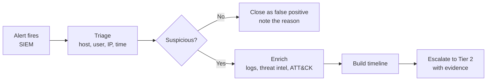

<div align="center">



<br>


[](https://www.linkedin.com/in/harshit-thakur-infosec/)
[](mailto:harshitthakur.2206@gmail.com)
[](https://tryhackme.com/p/severuss)

</div>

---

## 🛡️ $ whoami

```yaml
  name       : Harshit Thakur
  role       : BCA student · aspiring SOC Analyst (Tier 1)
  location   : Madhya Pradesh, India
  education  : BCA, Barkatullah University, Bhopal
  focus      : [ Log Analysis, Alert Triage, Threat Detection, Incident Response ]
  tools      : [ Splunk (SPL), Wazuh, Wireshark, Python, Linux ]
  next_up    : MCA, then deeper systems and detection engineering
  looking_for: SOC internships
```


I’m a BCA student training for a SOC analyst role. I’m learning to read logs, triage alerts, and explain what happened and why, and I practice on TryHackMe and LetsDefend. I’m building a home SIEM lab with Wazuh, using Kali to simulate attacks and Windows and Metasploitable as targets, so I can investigate real alerts from attack to conclusion. I already know Python and Linux, and I’m using them to automate log analysis. Every investigation I finish gets written up on this profile.


## 📊 Progress (updated as I go)

| TryHackMe | LetsDefend | Home lab | Case studies |
|:--:|:--:|:--:|:--:|
| Pre Security, Cyber Security 101 done · SOC L1 in progress | 1 alerts so far | planned | 1 published |

---

## 🔎 $ cat how_i_investigate.md

`Alert → Scope (host, user, IP, time) → Evidence in logs → True/False positive → Timeline → Recommendation`

Real write-ups will be linked here as I publish them.

---

## 📈 $ git log --stats


---

## 🧭 $ cat soc_playbook.md — how I plan to handle an alert


# SOC Investigations

Alert investigations from LetsDefend and my home lab. Each write-up follows
Scenario → Evidence → Timeline → Finding → Recommendation.

| # | Alert | Type | Verdict | MITRE |
|---|---|---|---|---|
| 1 | [SOC335: CVE-2024-49138 exploitation](letsdefend/soc335-cve-2024-49138/) | Privilege escalation | True positive | T1036, T1068 |

---

## 📒 $ cat training.log

```
[2026] TryHackMe: Pre Security, Cyber Security 101 completed
[2026] TryHackMe: SOC Level 1 in progress
[2026] Splunk (SPL) basics completed
[NEXT] LetsDefend alert investigations
[NEXT] Home SIEM lab (Wazuh + Kali + Windows + Metasploitable)
[NEXT] 3 case studies: phishing, endpoint detection, network threat hunt
```

---

## ⚔️ $ cat ./arsenal.conf

<table>
<tr>
<td width="50%" valign="top">

**🔵 Blue Team: Detect & Respond**


<sub>Log analysis · alert triage · SPL searches · traffic analysis</sub>

</td>
<td width="50%" valign="top">

**🔴 Red Team: Basics**


<sub>Recon and web testing fundamentals. Deeper offensive work comes later.</sub>

</td>
</tr>
<tr>
<td width="50%" valign="top">

**💻 Code & Data**


<sub>Scripting for log parsing and automation</sub>

</td>
<td width="50%" valign="top">

**🧭 Learning Next**


<sub>Detection engineering and threat hunting</sub>

</td>
</tr>
</table>

---

## 📜 $ cat ./certifications.log

<details open>
<summary><b>🔐 Cybersecurity</b></summary>

| Certification | Issuer | Date |
|---|---|---|
| Cyber Security 101 | TryHackMe | 2026 |

</details>

<details>
<summary><b>🐍 Data & AI</b></summary>

| Certification | Issuer | Date |
|---|---|---|
| Python for Data Science | Cognitive Class | Jan 2025 |
| BCG GenAI Job Simulation | Forage | Jan 2025 |

</details>

<details>
<summary><b>🌐 Networking</b></summary>

| Certification | Issuer | Date |
|---|---|---|
| Add your Cisco course once you finish it | Cisco Networking Academy | |

</details>

---

## 🧪 Projects
Coming soon: Python log analyzer, Wazuh home lab, SOC case studies.
